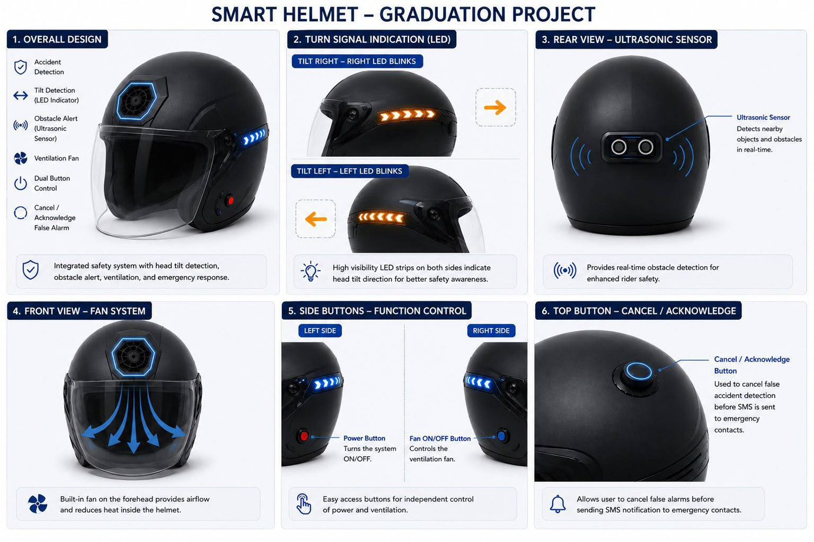
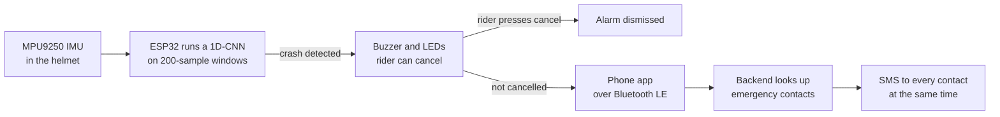
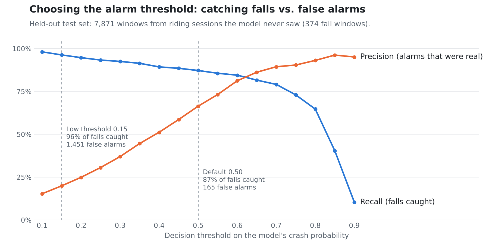

# Smart Helmet: on-device crash detection for motorcycle riders

**Graduation project · Communications & Electronics Engineering, Alexandria University · 2026 · graded A+**

A helmet protects a rider during a crash, but it can't call for help afterwards. This project turns the helmet into an active safety device: a motion sensor in the helmet feeds a small neural network running on the helmet's own microcontroller, and when it detects a crash the rider's emergency contacts get an SMS automatically.

---

## How it works

- **Helmet:** custom PCB with an ESP32-WROOM-32, MPU9250 motion sensor (accelerometer and gyroscope), rear ultrasonic obstacle sensor, LED turn signals driven by head tilt, a ventilation fan and an LFP battery.
- **On-device AI:** the crash model is trained in TensorFlow, converted to TensorFlow Lite and compiled into the firmware with TensorFlow Lite Micro, so detection works without a network connection.
- **Cancel button:** a dropped helmet can look like a crash, so the rider can cancel the alarm before any SMS goes out. That keeps false alarms from reaching their family.
- **Mobile app and backend:** React Native app connected to the helmet over Bluetooth LE, a three-tier backend with a SQL Server database, and Twilio for SMS.
- **Heart-rate module:** a separate wrist sensor (MAX30102 with an ESP32) tracks the rider's pulse.

---

## The crash-detection model

### Data

There are very few public motorcycle crash datasets, so the model combines two:

| Dataset | What it contains | How it's used |
|---|---|---|
| [IMU Data for different Motorcyclist Behaviour](https://researchdata.tuwien.ac.at/records/re6xk-ydq75) (TU Wien) | About 5.1 million IMU readings from real rides near Vienna, labelled cruise, fun, overtake, traffic and wait | Normal riding. Kept cruise, fun and overtake (3.05 million rows). Dropped traffic and wait, which weren't relevant to the behaviour being monitored |
| [Powered two-wheeler fall and critical events dataset](https://www.ncbi.nlm.nih.gov/pmc/articles/PMC6660605/) (Boubezoul et al.) | 11 controlled test-track sessions: falls, near-falls and limit manoeuvres | 9 sessions labelled as dangerous events (falls, fall-like manoeuvres, harsh braking, a badly degraded track). The 2 hard-acceleration sessions go into normal riding, so the model learns that aggressive riding is not a crash |

**Cleaning:** kept the six motion channels (ax, ay, az, gx, gy, gz), removed the all-zero rows each fall recording starts with while the sensor initialises, and rescaled the gyroscope readings so both datasets use the same units. The 3-million-row riding file was split into 13 pseudo-sessions so it could be divided by session like the fall data.

### Windowing

Each recording is cut into **windows of 200 samples with 50% overlap**, and each window is one training example. The overlap matters: with back-to-back windows, a crash that lands on the boundary gets split in half and neither window looks like a crash. With 50% overlap, every event falls completely inside at least one window.

This produced **32,317 normal windows and 9,525 fall windows** from 24 sessions.

### Splitting without leakage

Neighbouring windows overlap, so splitting windows at random would put near-copies of the same moment in both training and test data. Instead, splits are made by **whole session**:

- **Test set:** 2 fall sessions and 3 riding sessions held out completely. Falls were kept to about 5% of the test windows, close to how rare they are in real riding, so precision means something.
- **Training and validation:** 5-fold cross-validation over the remaining fall sessions.
- **Normalisation:** mean and standard deviation computed from training data only.

### Handling class imbalance

Normal riding outnumbers falls by more than 3 to 1, and a model can look accurate by always answering "normal". Two fixes work together:

1. **Oversampling:** in each training fold, fall windows are resampled up to half the number of normal windows. Going all the way to 1:1 would mean repeating the same few fall windows many times and overfitting to them.
2. **Focal loss** (α = 0.75, γ = 2): gives fall windows more weight and focuses training on hard examples instead of the easy ones the model already gets right.

### Model

A small 1D convolutional network, sized to fit on the ESP32:

| Layer | Details |
|---|---|
| Input | 200 samples × 6 channels |
| Conv block 1 | Conv1D, 32 filters, kernel 7 → BatchNorm → MaxPool → Dropout 0.2 |
| Conv block 2 | Conv1D, 64 filters, kernel 5 → BatchNorm → MaxPool → Dropout 0.2 |
| Conv block 3 | Conv1D, 64 filters, kernel 3 → BatchNorm → MaxPool → Dropout 0.3 |
| Global average pooling | Used instead of Flatten to keep the parameter count low |
| Dense + sigmoid | Probability that the window is a crash |

**24,737 parameters** in total, about 97 KB in float32. Trained with Adam (learning rate 0.001, batch size 64, up to 40 epochs) with early stopping and learning-rate reduction on plateau. The best fold was chosen by validation F1.

---

## Results

On the held-out test set (7,871 windows from sessions the model never saw), at the default threshold of 0.5:

| Metric | Value |
|---|---|
| Falls caught (recall) | **87.2%** |
| Alarms that were real falls (precision) | 66.4% |
| False alarm rate on normal riding | **2.2%** |
| ROC-AUC | 0.979 |
| PR-AUC | 0.862 |
| Accuracy | 97.3% |

|  | Predicted normal | Predicted crash |
|---|---|---|
| **Actual normal** | 7,332 | 165 |
| **Actual crash** | 48 | 326 |

Across the 5 cross-validation folds, mean validation F1 was 0.857 ± 0.057.

### Choosing the threshold

For a safety system a missed crash costs far more than a false alarm, so the threshold is a design decision rather than a default.

<picture>
  <source media="(prefers-color-scheme: dark)" srcset="images/threshold-tradeoff-dark.png">
  
</picture>

Lowering the threshold to 0.15 catches 96% of falls but multiplies false alarms almost ninefold. The cancel button is what makes a low, safety-first threshold workable: the rider can dismiss a false alarm before it reaches anyone.

---

## Limitations and next steps

- **Align sampling rates before windowing.** The fall recordings are sampled at 1000 Hz and the riding data at a much lower rate. In this version both are cut into 200-sample windows, so a fall window covers a much shorter stretch of time than a riding window. Resampling everything to one rate first, then retraining, is the most important fix.
- **Exact gyroscope unit conversion.** The riding data's gyroscope is in rad/s and the fall data's in °/s. This version scales by 10; the exact factor is 180/π ≈ 57.3.
- **More fall data.** The test set holds out only 2 fall sessions, so the numbers above will move with more data.
- **Test on the helmet itself.** Both datasets were recorded with different sensors from the helmet's MPU9250, so real riding tests with the helmet are needed to confirm the results and set the final threshold.

---

## Repository contents

| File | What it is |
|---|---|
| `Grad_version3.ipynb` | Final pipeline: loading, cleaning, windowing, session-level split, 5-fold cross-validation, training, test evaluation and threshold analysis |
| `Grad-version2.ipynb`, `grad_project.ipynb` | Earlier iterations |
| `Requirements` | Python dependencies |

The datasets aren't included; download them from the links above. The notebooks were run in Google Colab with the data in Google Drive.

## Team

- **Perihane Tarek:** model training, class balancing and window design for the crash-detection model
- **Basmala** ([@Basmala135](https://github.com/Basmala135)): hardware design and TinyML implementation
